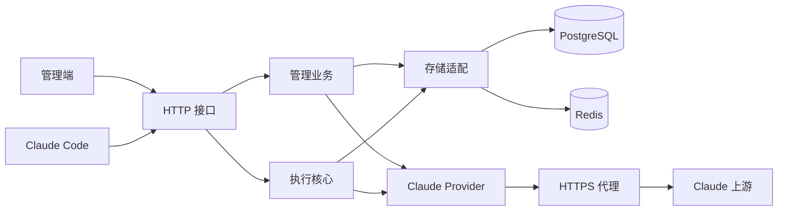

# 开发说明

## 环境与启动

项目采用 Rust workspace 和 Vue 3 管理端。当前验证环境为 macOS arm64；Linux 应用镜像、真实 Claude 账号联调及持续负载验证仍待完成。

| 工具 | 要求或已验证版本 |
| --- | --- |
| Rust | 1.99.1，包含 Cargo、rustfmt、Clippy；仓库通过 `rust-toolchain.toml` 固定 |
| Node.js／pnpm | 本机验证 Node.js 24.19.0；pnpm 11.25.0，由 `frontend/package.json` 固定 |
| Python | Python 3，运行开发入口与 HTTP 验收脚本 |
| Docker | 可用的 Docker Engine 或桌面运行时，以及 Compose 插件 |
| TLS 原生依赖 | C/C++ 编译器、CMake、Ninja、Clang／libclang；macOS 可使用 Xcode Command Line Tools |
| 数据库客户端 | 完整测试需要 PostgreSQL 18 的 `pg_dump`、`psql`；数据库服务本身由 Compose 提供 |

依赖应在当前终端 PATH 中可用。`scripts/dev` 也兼容 `~/DevSoftware` 下已有的可选工具目录，不要求统一安装位置。

从项目根目录执行：

```sh
./scripts/dev init
pnpm --dir frontend install --frozen-lockfile
./scripts/dev build-web
./scripts/dev backend
```

开发前端时，在另一个终端执行 `./scripts/dev frontend`。Vite 在 `http://127.0.0.1:5173` 提供页面，并将 API 请求转发到本机后端。生产构建产物位于 `frontend/dist/`。

私有配置、代理出口及账号接入见 [README](../README.md)；服务操作见 [部署说明](../deploy/README.md)。

## 架构与目录

后端是模块化单体：多个 crate 组装成一个主要网关进程。管理页面作为独立静态资源提供，持久数据位于 PostgreSQL，Redis 用于会话、租约和并发协调。



| 路径 | 职责 |
| --- | --- |
| `backend/apps/gateway` | 进程入口、配置加载、模块组装与任务注册 |
| `backend/crates/gateway-api` | HTTP 解码、业务调用及 JSON／SSE 交付 |
| `backend/crates/gateway-admin` | 账号、密钥、代理、设置等管理用例与接口 |
| `backend/crates/gateway-core` | 请求准入、账号选择、执行生命周期、并发及结算语义 |
| `backend/crates/gateway-store` | PostgreSQL 持久化与 Redis 协调实现 |
| `backend/crates/gateway-host` | 配置、日志、证书、进程与运行环境能力 |
| `backend/crates/providers/claude` | OAuth、凭据刷新、Messages、SSE 用量、身份与 TLS |
| `backend/crates/gateway-protocol`、`gateway-plugin` | 继承的协议及插件基础；存在通用合同不代表产品开放其他平台 |
| `backend/migrations` | 已编号的数据库迁移及冻结校验清单 |
| `frontend/src` | 页面、组件、接口调用、状态、路由和多语言 |
| `scripts` | 开发脚本与真实 HTTP 边界的本地模拟验收 |
| `tools/tls-probe` | 独立的本地 TLS 对照工具，不是生产服务 |
| `deploy`、`release` | 配置／构建模板和版本元数据 |

Core 不直接依赖数据库或具体 Provider，实现由启动层注入。Messages 使用 wreq／BoringSSL；OAuth、刷新和目录查询使用 Reqwest。产品注册的内置上游为 Claude。

## 验证命令

```sh
./scripts/dev check
./scripts/dev test
pnpm --dir frontend lint
./scripts/dev build-web
```

Rust 格式与严格静态检查可单独执行：

```sh
cargo fmt --manifest-path backend/Cargo.toml --all -- --check
cargo clippy --manifest-path backend/Cargo.toml --workspace --all-targets --locked -- -D warnings
```

先构建应用二进制，再运行 HTTP 验收；各命令按顺序执行：

```sh
cargo build --manifest-path backend/Cargo.toml -p claude-code-proxy-rs --locked
python3 scripts/verify-claude-oauth.py
python3 scripts/verify-claude-messages.py
python3 scripts/verify-claude-identity.py
python3 scripts/verify-claude-client-profile.py
```

这些脚本运行隔离应用与本地模拟上游，使用 `connections.env` 中的测试连接，结束后清理夹具。`verify-baseline.py` 则需要已启动的本机服务。`verify-claude-accounts.py` 提供共享夹具，并验证旧 API Key 新增请求被拒绝；OAuth／Setup Token 的当前行为由 OAuth 验收覆盖。

## 测试数据隔离

- Docker 初始化创建 `claude_code_proxy_test`，Rust／HTTP 验收使用隔离 schema。
- Redis 正常开发使用 DB0，测试默认 DB15。不要同时运行会清理同一测试逻辑库的验收。
- 若必须与 Rust 回归并行，HTTP 脚本可设置 `CPR_HTTP_TEST_REDIS_DATABASE=14`。
- `scripts/dev test` 注入测试连接，并清除可能误指向正常开发库的部署连接变量。手动运行 Cargo 集成测试时，应按[迁移说明](../backend/migrations/README.md#本地测试库)设置测试环境。
- 未配置数据库而跳过测试，不能记为数据库验收通过。

## TLS 捕获与证书

内置模板的公开基线在 [scripts/fixtures/claude-2.1.312-macos-arm64-tls.json](../scripts/fixtures/claude-2.1.312-macos-arm64-tls.json)。它来自本地实际 Claude Code、假 API Key、临时配置及仅允许环回网络的捕获，不包含真实账号凭据。

重新捕获需要 macOS 的 `sandbox-exec`、已安装的对应 Claude Code 客户端、OpenSSL 和本机原生构建工具：

```sh
cargo build --manifest-path tools/tls-probe/Cargo.toml --locked
python3 scripts/verify-claude-tls.py
```

捕获结果与本地日志写入被忽略的 `.runtime/`。其他平台上的可执行测试范围需单独确认，不应将未经执行的实际客户端捕获记为通过。

信任材料使用系统根证书，可通过 `CLAUDE_PROXY_CA_CERTIFICATE` 或 `SSL_CERT_FILE` 添加 CA；前者优先。Messages 的信任材料按进程固定，修改后需要重启。模板匹配范围、首个模板版本和代理内外层差异见 [README](../README.md#客户端身份与-tls)。

## 提交内容

提交源码、测试、配置模板、数据库迁移、依赖锁文件和必要开发文档。测试假 Token、专用于本地测试的证书及捕获基线属于可复现验证材料。

不提交 `.env`、`connections.env`、`deploy/config.yaml`、真实凭据、运行数据、日志、依赖目录或构建产物。`.runtime/` 同时包含运行数据与验证产物，不能将整个目录视为可随意删除的缓存。

全量回归和本地模拟结果不替代真实 Claude 联调或性能实测。开发计划与验收目标统一维护在 [ROADMAP](../ROADMAP.md)。
